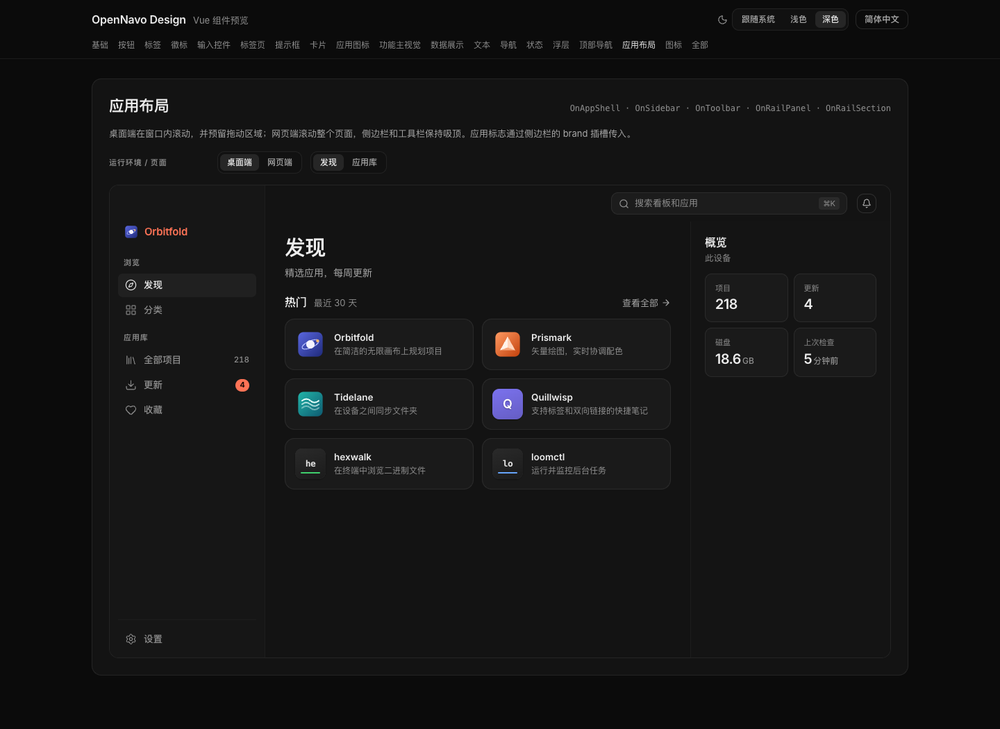

[English](../../../README.md) · **简体中文** · [繁體中文](../zh-Hant/README.md) · [日本語](../ja-JP/README.md) · [Español](../es-ES/README.md) · [Português (Brasil)](../pt-BR/README.md) · [Русский](../ru-RU/README.md) · [Deutsch](../de-DE/README.md) · [Français](../fr-FR/README.md) · [Italiano](../it-IT/README.md)

> 英文为源文。新增翻译由本机离线工具辅助生成，仍需母语审校；代码和许可证原文保持不变。

# OpenNavo Design

[OpenNavo](https://opennavo.com)（免费、开源的 Mac 版 Homebrew 应用商店）背后的设计规范，也是 OpenNavo 系列其他 App 共用的一套设计系统：一份设计令牌、一套成文规范和现成的组件，让系列里的每个 App 在深色和浅色下都长得一样、说话一样、用起来一样。

## 预览

### 深色主题



### 浅色主题


### 组件


## 语言和版本状态

组件默认使用英语（`en-US`），翻译以英文为源。预览页首次打开默认英文；只有 URL 参数或已保存的明确选择才会改变语言，不自动跟随浏览器语言。组件同时支持简体中文、繁体中文、日语、西班牙语、巴西葡萄牙语、俄语、德语、法语和意大利语。

文档、代码注释、开发工具和 GitHub 发布说明默认英文，各语言文档以英文为源。

0.1.0 是早期预览版：1.0 之前 API 可能调整，包尚未发布到软件包仓库。安全漏洞请按 [SECURITY.md](SECURITY.md) 私密报告。

## 仓库里有什么

| 路径                                                                                    | 包名                      | 用途                                                                                                                             |
| --------------------------------------------------------------------------------------- | ------------------------- | -------------------------------------------------------------------------------------------------------------------------------- |
| [`tokens/tokens.json`](../../../tokens/tokens.json)                                     | —                         | 唯一的来源：颜色（深色 + 浅色）、字号、间距、圆角、阴影、动效、布局尺寸                                                          |
| [`packages/tokens`](../../../packages/tokens)                                           | `@opennavo/design-tokens` | 两套主题的 CSS 变量、UnoCSS 预设、Tailwind CSS v4 主题和 v3 预设、带类型的取值、给设计工具用的 DTCG 文件、主题切换工具、基础样式 |
| [`packages/vue`](../../../packages/vue)                                                 | `@opennavo/design-vue`    | Vue 3 组件（按钮、菜单、对话框、表格、应用外壳等）、基础样式、组件预览页                                                         |
| [`packages/swift`](../../../packages/swift) + [`Package.swift`](../../../Package.swift) | `OpenNavoDesign`          | SwiftUI 令牌：随外观变化的颜色、间距、字体、动效                                                                                 |
| [`packages/flutter`](../../../packages/flutter)                                         | `opennavo_design`         | Flutter 令牌（`ThemeExtension`）和 `ThemeData` 生成函数                                                                          |
| [`docs`](docs/README.md)                                                                | —                         | 成文规范：原则、颜色、主题、组件、交互模式、文案、无障碍                                                                         |

标着“generated”的文件都由 `pnpm gen` 从 `tokens/tokens.json` 生成，手改或没更新时 CI 会失败。

## 快速开始

这些包还没发布到 npm、pub 或 Swift 包索引，先直接依赖本仓库（pnpm 的 git 子目录依赖、SwiftPM、pub 的 `git` 依赖），或者把 `packages/tokens/dist` 复制到自己的项目里。

### Vue 3 + UnoCSS（Vite、Tauri）

```ts
// main.ts — order matters: reset, tokens, base styles, system fonts, then UnoCSS
import '@unocss/reset/tailwind.css';
import '@opennavo/design-tokens/tokens.css';
import '@opennavo/design-vue/base.css';
import '@opennavo/design-vue/system-fonts.css';
import 'virtual:uno.css';
import { createOnUi } from '@opennavo/design-vue';

app.use(createOnUi({ locale })); // a ref with one of the ten locales
```

```ts
// uno.config.ts
import { defineConfig, presetWind3 } from 'unocss';
import { presetOpenNavo } from '@opennavo/design-tokens/uno-preset';

export default defineConfig({ presets: [presetWind3(), presetOpenNavo()] });
```

Nuxt 的配置、组件包的样式扫描和组件清单见 [`packages/vue/README.md`](packages/vue/README.md)。

```vue
<OnButton variant="primary" icon="download">Install</OnButton>
<OnCard><p class="text-body text-ink-secondary">Only on this Mac; nothing is uploaded.</p></OnCard>
```

### React + Tailwind CSS v4

```css
@import 'tailwindcss';
@import '@opennavo/design-tokens/tailwind.css';
```

完整示例（含主题切换）在 [`examples/react-tailwind`](../../../examples/react-tailwind)。

```tsx
<button className="h-[34px] rounded-default bg-button-primary-bg px-4 text-[13px] font-semibold text-button-primary-text">
  Install
</button>
```

### SwiftUI

```swift
.package(url: "https://github.com/opennavo/opennavo-design.git", branch: "main")

Text("Installed").onTextStyle(OnTypography.bodySm).foregroundStyle(OnColor.statusSuccess)
```

### Flutter

```yaml
opennavo_design:
  git: { url: https://github.com/opennavo/opennavo-design.git, path: packages/flutter }
```

```dart
MaterialApp(theme: onThemeData(Brightness.light), darkTheme: onThemeData(Brightness.dark));
```

## 深色、浅色、跟随系统

默认是深色；没有手动指定时跟随系统外观。网页上的选择体现为 `<html>` 上的 `data-theme` 属性（用 `applyThemePreference()` 切换，`<head>` 里一小段脚本保证保存过的选择在首帧前就生效，不会闪一下）；Tauri 客户端只需设置一次原生外观，所有窗口和网页视图都会跟着变；SwiftUI 和 Flutter 按当前外观取色。详见 [docs/theming.md](docs/theming.md)。

## 规范

从 [docs/README.md](docs/README.md) 开始读。原则一句话概括：内容优先，先说清会发生什么，数据留在本机，界面在操作时不乱跳，尊重平台习惯，默认安静，所有 App 用同一套系统，无障碍从一开始就做进去，每种语言都放得下。

## 开发

需要 Node 24、pnpm 10；原生包另需 Swift 5.9+（Xcode）和 Flutter 3.24+。

```sh
pnpm install
pnpm gen          # render every generated file from tokens/tokens.json (and the icon subset)
pnpm check        # fail if any generated file is stale
pnpm test         # token contrast and output tests, Vue component tests
pnpm typecheck
pnpm gallery      # component gallery at http://127.0.0.1:6106 with a theme and language switch
swift test        # SwiftUI package
(cd packages/flutter && flutter test)
```

改令牌只改 `tokens/tokens.json`，然后运行 `pnpm gen`，把生成的文件和改动一起提交。详见 [CONTRIBUTING.md](CONTRIBUTING.md)。

## 许可

代码和文档采用 [MIT 许可](../../../LICENSE)。OpenNavo 的名称和图标不在许可范围内，见 [TRADEMARKS.md](TRADEMARKS.md)。仓库里附带的第三方素材保留各自的许可：Lucide 图标子集为 ISC 许可（见 [packages/vue/THIRD_PARTY_NOTICES.md](packages/vue/THIRD_PARTY_NOTICES.md)）。

代码来源与单独 MIT 授权说明：[PROVENANCE.md](PROVENANCE.md)。
