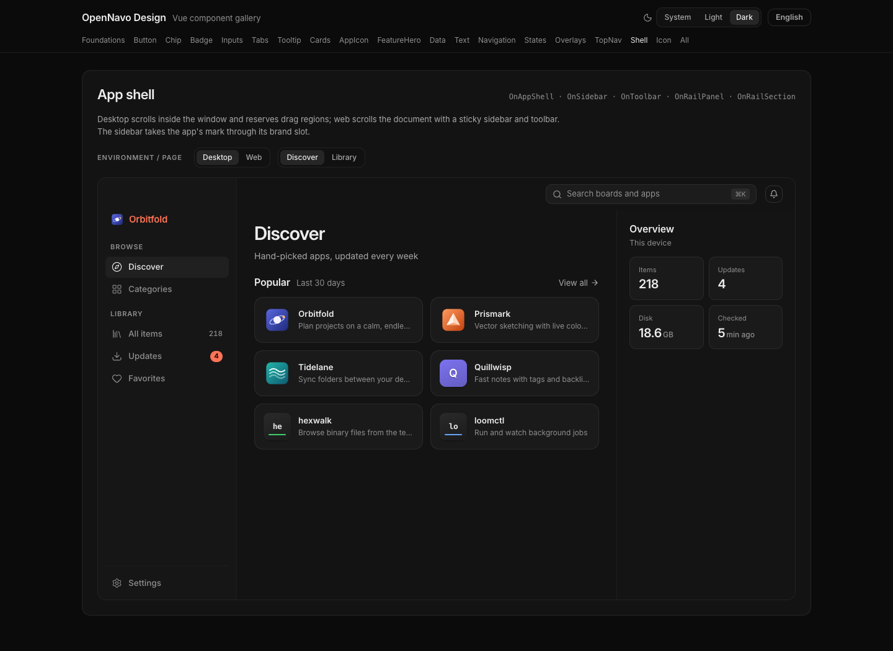
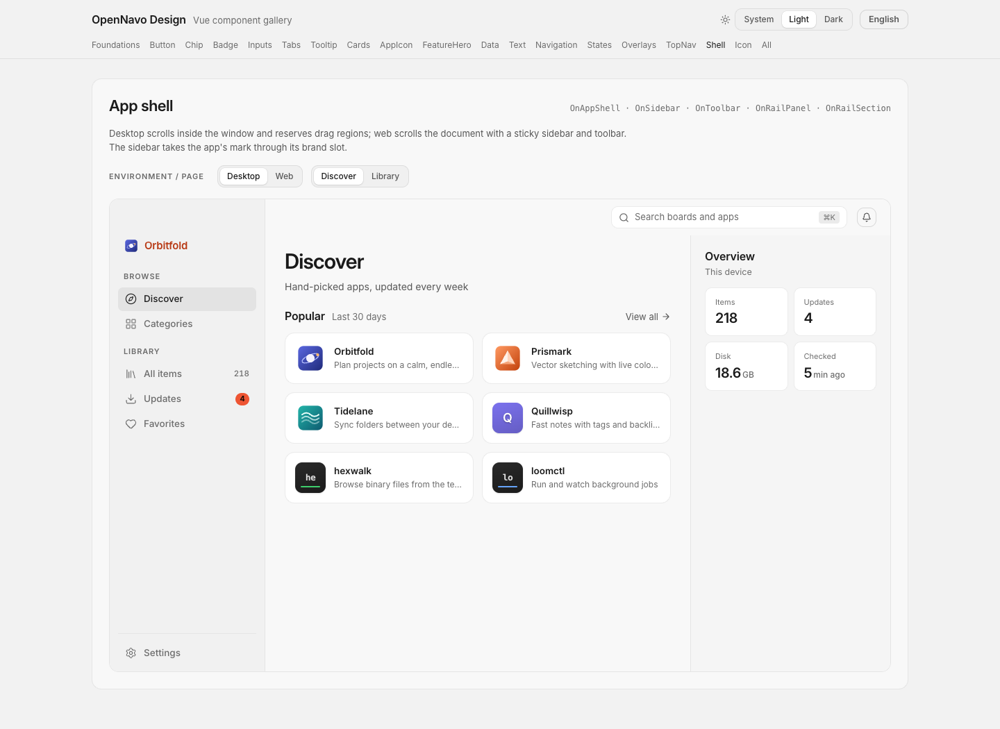
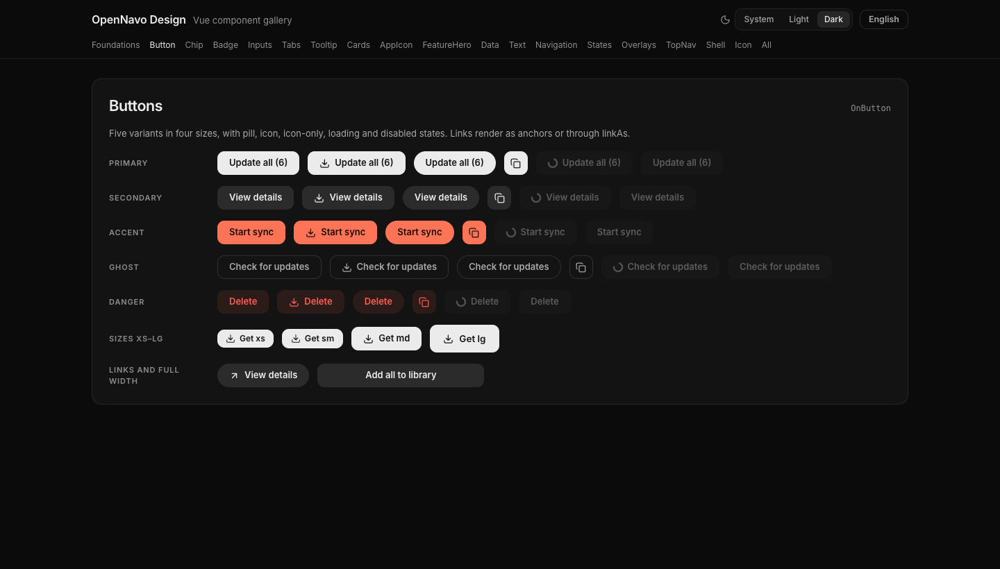

[English](../../../README.md) · [简体中文](../zh-CN/README.md) · **繁體中文** · [日本語](../ja-JP/README.md) · [Español](../es-ES/README.md) · [Português (Brasil)](../pt-BR/README.md) · [Русский](../ru-RU/README.md) · [Deutsch](../de-DE/README.md) · [Français](../fr-FR/README.md) · [Italiano](../it-IT/README.md)

> 英文為來源文件。新增翻譯由本機離線工具輔助產生，仍需母語審校；程式碼與授權條款原文維持不變。

# OpenNavo Design

[OpenNavo](https://opennavo.com)（免費、開源的 Mac 版 Homebrew 應用商店）背後的設計規範，也是 OpenNavo 系列其他 App 共用的一套設計系統：一份設計令牌、一套成文規範和現成的元件，讓系列裡的每個 App 在深色和淺色下都長得一樣、說話一樣、用起來一樣。

## 預覽

### 深色主題



### 淺色主題



### 元件



## 語言和版本狀態

元件預設使用英語（`en-US`），翻譯以英文為源。預覽頁首次開啟預設英文；只有 URL 引數或已儲存的明確選擇才會改變語言，不自動跟隨瀏覽器語言。元件同時支援簡體中文、繁體中文、日語、西班牙語、巴西葡萄牙語、俄語、德語、法語和義大利語。

文件、程式碼註解、開發工具與 GitHub 發布說明預設使用英文，各語言文件以英文為來源。

0.1.0 是早期預覽版：1.0 之前 API 可能調整，包尚未釋出到軟體包倉庫。安全漏洞請按 [SECURITY.md](SECURITY.md) 私密報告。

## 倉庫裡有什麼

| 路徑                                                                                    | 包名                      | 用途                                                                                                                             |
| --------------------------------------------------------------------------------------- | ------------------------- | -------------------------------------------------------------------------------------------------------------------------------- |
| [`tokens/tokens.json`](../../../tokens/tokens.json)                                     | —                         | 唯一的來源：顏色（深色 + 淺色）、字號、間距、圓角、陰影、動效、佈局尺寸                                                          |
| [`packages/tokens`](../../../packages/tokens)                                           | `@opennavo/design-tokens` | 兩套主題的 CSS 變數、UnoCSS 預設、Tailwind CSS v4 主題和 v3 預設、帶型別的取值、給設計工具用的 DTCG 檔案、主題切換工具、基礎樣式 |
| [`packages/vue`](../../../packages/vue)                                                 | `@opennavo/design-vue`    | Vue 3 元件（按鈕、選單、對話方塊、表格、應用外殼等）、基礎樣式、元件預覽頁                                                       |
| [`packages/swift`](../../../packages/swift) + [`Package.swift`](../../../Package.swift) | `OpenNavoDesign`          | SwiftUI 令牌：隨外觀變化的顏色、間距、字型、動效                                                                                 |
| [`packages/flutter`](../../../packages/flutter)                                         | `opennavo_design`         | Flutter 令牌（`ThemeExtension`）和 `ThemeData` 生成函式                                                                          |
| [`docs`](docs/README.md)                                                                | —                         | 成文規範：原則、顏色、主題、元件、互動模式、文案、無障礙                                                                         |

標著“generated”的檔案都由 `pnpm gen` 從 `tokens/tokens.json` 生成，手改或沒更新時 CI 會失敗。

## 快速開始

這些包還沒釋出到 npm、pub 或 Swift 包索引，先直接依賴本倉庫（pnpm 的 git 子目錄依賴、SwiftPM、pub 的 `git` 依賴），或者把 `packages/tokens/dist` 複製到自己的專案裡。

### Vue 3 + UnoCSS（Vite、Tauri）

```ts
// main.ts — order matters: reset, tokens, base styles, system fonts, then UnoCSS
import '@unocss/reset/tailwind.css';
import '@opennavo/design-tokens/tokens.css';
import '@opennavo/design-vue/base.css';
import '@opennavo/design-vue/system-fonts.css';
import 'virtual:uno.css';
import { createOnUi } from '@opennavo/design-vue';

app.use(createOnUi({ locale })); // a ref with one of the ten locales
```

```ts
// uno.config.ts
import { defineConfig, presetWind3 } from 'unocss';
import { presetOpenNavo } from '@opennavo/design-tokens/uno-preset';

export default defineConfig({ presets: [presetWind3(), presetOpenNavo()] });
```

Nuxt 的配置、元件包的樣式掃描和元件清單見 [`packages/vue/README.md`](packages/vue/README.md)。

```vue
<OnButton variant="primary" icon="download">Install</OnButton>
<OnCard><p class="text-body text-ink-secondary">Only on this Mac; nothing is uploaded.</p></OnCard>
```

### React + Tailwind CSS v4

```css
@import 'tailwindcss';
@import '@opennavo/design-tokens/tailwind.css';
```

完整示例（含主題切換）在 [`examples/react-tailwind`](../../../examples/react-tailwind)。

```tsx
<button className="h-[34px] rounded-default bg-button-primary-bg px-4 text-[13px] font-semibold text-button-primary-text">
  Install
</button>
```

### SwiftUI

```swift
.package(url: "https://github.com/opennavo/opennavo-design.git", branch: "main")

Text("Installed").onTextStyle(OnTypography.bodySm).foregroundStyle(OnColor.statusSuccess)
```

### Flutter

```yaml
opennavo_design:
  git: { url: https://github.com/opennavo/opennavo-design.git, path: packages/flutter }
```

```dart
MaterialApp(theme: onThemeData(Brightness.light), darkTheme: onThemeData(Brightness.dark));
```

## 深色、淺色、跟隨系統

預設是深色；沒有手動指定時跟隨系統外觀。網頁上的選擇體現為 `<html>` 上的 `data-theme` 屬性（用 `applyThemePreference()` 切換，`<head>` 裡一小段指令碼保證儲存過的選擇在首幀前就生效，不會閃一下）；Tauri 客戶端只需設定一次原生外觀，所有視窗和網頁檢視都會跟著變；SwiftUI 和 Flutter 按當前外觀取色。詳見 [docs/theming.md](docs/theming.md)。

## 規範

從 [docs/README.md](docs/README.md) 開始讀。原則一句話概括：內容優先，先說清會發生什麼，資料留在本機，介面在操作時不亂跳，尊重平臺習慣，預設安靜，所有 App 用同一套系統，無障礙從一開始就做進去，每種語言都放得下。

## 開發

需要 Node 24、pnpm 10；原生包另需 Swift 5.9+（Xcode）和 Flutter 3.24+。

```sh
pnpm install
pnpm gen          # render every generated file from tokens/tokens.json (and the icon subset)
pnpm check        # fail if any generated file is stale
pnpm test         # token contrast and output tests, Vue component tests
pnpm typecheck
pnpm gallery      # component gallery at http://127.0.0.1:6106 with a theme and language switch
swift test        # SwiftUI package
(cd packages/flutter && flutter test)
```

改令牌只改 `tokens/tokens.json`，然後執行 `pnpm gen`，把生成的檔案和改動一起提交。詳見 [CONTRIBUTING.md](CONTRIBUTING.md)。

## 許可

程式碼和文件採用 [MIT 許可](../../../LICENSE)。OpenNavo 的名稱和圖示不在許可範圍內，見 [TRADEMARKS.md](TRADEMARKS.md)。倉庫裡附帶的第三方素材保留各自的許可：Lucide 圖示子集為 ISC 許可（見 [packages/vue/THIRD_PARTY_NOTICES.md](packages/vue/THIRD_PARTY_NOTICES.md)）。

程式碼來源與單獨 MIT 授權說明：[PROVENANCE.md](PROVENANCE.md)。
